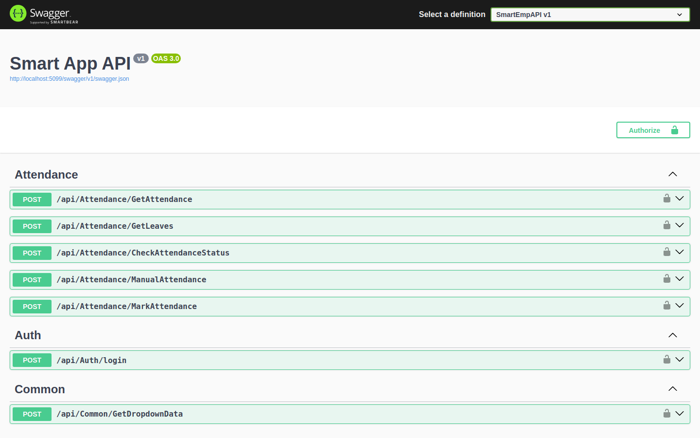
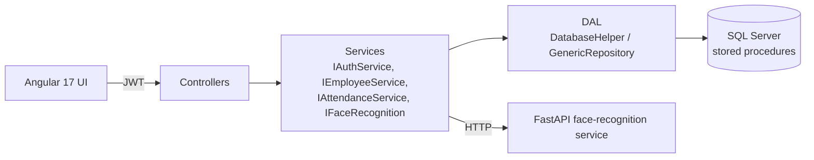

# 🏢 Smart Employee Portal — Backend API

> ASP.NET Core 8 Web API for the **Smart Employee Portal**, an HR and attendance platform. It provides JWT authentication with role/permission profiles, employee management, attendance and leave records, and integrates with a Python face-recognition service for biometric check-in.

[](https://dotnet.microsoft.com)
[](https://learn.microsoft.com/dotnet/csharp/)
[](https://www.microsoft.com/sql-server)
[](https://github.com/yasirmalik36/smart-employee-portal-backend/actions/workflows/ci.yml)
[](LICENSE)

---

## 📸 Screenshot

The Swagger UI, captured from the running API by the [Refresh screenshots](.github/workflows/screenshots.yml) workflow:



## ✨ Features

- 🔐 **JWT authentication** — login returns a signed token plus the user's role / permission profiles; all other controllers require `[Authorize]`
- 🔑 **Secure passwords** — hashed with ASP.NET Core Identity's `PasswordHasher`; admin password reset endpoint
- 👤 **Employees** — create / update employees, fetch details and profile info
- 🕐 **Attendance & leave** — mark attendance, manual attendance, status checks, attendance and leave history
- 📸 **Face recognition** — enrol, verify liveness, list and delete employee faces via the [face-recognition service](https://github.com/yasirmalik36/smart-employee-portal-face-recognition)
- 📖 **Swagger UI** — with JWT bearer support for trying secured endpoints

---

## 🏗️ Architecture

A layered Web API: **Controllers → Services (behind interfaces) → DAL**. Data access is ADO.NET (`Microsoft.Data.SqlClient`) calling SQL Server **stored procedures** with parameterised commands.



```
SmartEmpAPI/
├── Controllers/   # Auth, Employee, Attendance, FaceRecognition, Common
├── Services/      # business logic, one per controller
├── Interfaces/    # service contracts (DI)
├── DAL/           # DatabaseHelper, GenericRepository (stored procedures)
├── DTOs/ Models/  # request / response types
├── Helpers/       # password hashing, utilities
└── Program.cs     # DI, JWT auth, CORS, Swagger
```

## 🔧 Tech stack

| Layer | Technology |
|-------|-----------|
| Framework | ASP.NET Core 8 Web API |
| Auth | JWT Bearer (`Microsoft.AspNetCore.Authentication.JwtBearer`) |
| Data | SQL Server, ADO.NET, stored procedures |
| Docs | Swagger / OpenAPI (Swashbuckle) |

---

## 🚀 Getting Started

### Prerequisites

- [.NET 8 SDK](https://dotnet.microsoft.com/download/dotnet/8.0)
- [SQL Server](https://www.microsoft.com/en-us/sql-server/sql-server-downloads) (or SQL Server Express)
- [Visual Studio 2022](https://visualstudio.microsoft.com/) or [VS Code](https://code.visualstudio.com/)

### 1. Clone the Repository

```bash
git clone https://github.com/yasirmalik36/smart-employee-portal-backend.git
cd smart-employee-portal-backend/SmartEmpAPI
```

### 2. Configure settings

`appsettings.json` contains **no secrets**. Point the connection string at your SQL Server, then store the JWT signing key with .NET user secrets (or an environment variable in production):

```bash
# from SmartEmpAPI/
dotnet user-secrets set "ConnectionStrings:DefaultConnection" "Server=localhost;Database=SMART_EMP;Trusted_Connection=True;TrustServerCertificate=True;"
dotnet user-secrets set "JwtSettings:SecretKey" "$(openssl rand -hex 32)"
```

| Setting | Env var equivalent | Notes |
|---|---|---|
| `ConnectionStrings:DefaultConnection` | `ConnectionStrings__DefaultConnection` | SQL Server database |
| `JwtSettings:SecretKey` | `JwtSettings__SecretKey` | **Required**, 32+ characters — the API refuses to start without it |
| `FaceRecognition:ApiUrl` | `FaceRecognition__ApiUrl` | URL of the [face-recognition service](https://github.com/yasirmalik36/smart-employee-portal-face-recognition) |

### 3. Database

Data access uses ADO.NET with SQL Server **stored procedures** (see `DAL/DatabaseHelper.cs`). The database schema and procedures are not included in this repository yet, so you'll need an existing `SMART_EMP` database to run end-to-end.

### 4. Run the API

```bash
dotnet run
```

API will be available at `http://localhost:5010` (or `https://localhost:7162` with the https profile) · Swagger UI at `/swagger`

---

## 📡 API endpoints

All routes are under `/api/{controller}`. Everything except login requires a bearer token.

| Controller | Method | Route |
|---|---|---|
| Auth | `POST` | `/api/Auth/login` |
| Employee | `GET` | `/api/Employee/GetEmployeeInfoByID`, `/api/Employee/GetEmployeeDetails` |
| Employee | `POST` | `/api/Employee/AddUpdateEmployee`, `/api/Employee/ResetEmployeePassword` |
| Attendance | `POST` | `/api/Attendance/MarkAttendance`, `ManualAttendance`, `CheckAttendanceStatus`, `GetAttendance`, `GetLeaves` |
| FaceRecognition | `POST` | `/api/FaceRecognition/SaveFace`, `/api/FaceRecognition/CheckLiveness` |
| FaceRecognition | `GET` / `DELETE` | `/api/FaceRecognition/GetEmployeeFaceDetails`, `/api/FaceRecognition/DeleteFace/{employeeId}` |
| Common | `POST` | `/api/Common/GetDropdownData` |

---

## 🔗 Related Repositories

| Repo | Description |
|------|-------------|
| [smart-employee-portal-frontend](https://github.com/yasirmalik36/smart-employee-portal-frontend) | Angular 17 frontend |
| [smart-employee-portal-face-recognition](https://github.com/yasirmalik36/smart-employee-portal-face-recognition) | Python face recognition service |

---

## 🤝 Author

**Yasir Mehmood** — Senior Full-Stack & AI Engineer

[](https://yasir-portfolio-omega.vercel.app)
[](https://linkedin.com/in/yasir-mehmood-53549a1b3)
[](mailto:yash36114@gmail.com)

---

## 📄 License

This project is licensed under the MIT License — see the [LICENSE](LICENSE) file for details.
